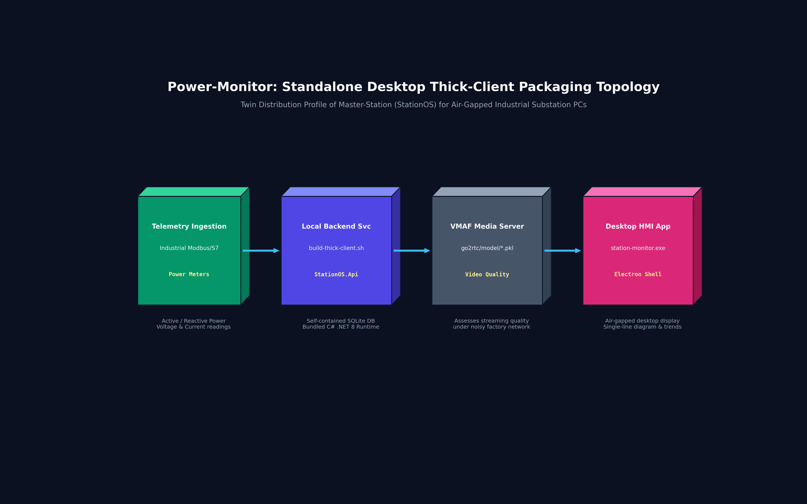

# Power-Monitor: StationOS Desktop Thick-Client Distribution
### Standalone Substation Electrical Telemetry, Power Quality Ingestion, and Local Monitoring Client

[](https://github.com/neitpm/Master-Station)
[-512BD4.svg)](https://github.com/neitpm/Master-Station)
[](https://dotnet.microsoft.com/)
[](docs-project/commercialization_and_licensing.md)

---

## 1. Upstream Relationship & Architectural Position

> **Architectural Verification Disclosure:**  
> **Power-Monitor** is a **direct twin repository and branded standalone thick-client distribution** of the **[`Master-Station`](https://github.com/neitpm/Master-Station)** (StationOS) platform.  
> 
> A line-by-line audit confirms that this repository shares the identical C# .NET 8 backend (`StationOS.sln`), database entity models (`StationOS.Data`), Python video auxiliary service (`ai_engine`), and React/Electron UI components as Master-Station. It does not train, host, or execute separate neural network power-prediction models.

---

## 2. Standalone Thick-Client Packaging Topology

Below is the isometric 3D volumetric tensor block diagram illustrating the air-gapped thick-client distribution:

#### Figure 1: Power-Monitor Desktop Thick-Client Distribution Topology
*Standalone industrial PC packaging combining local Snap7 telemetry polling, self-contained SQLite backend services, go2rtc VMAF quality monitoring, and the desktop Electron shell.*


---

## 3. Key Differentiation & Functional Scope

While `Master-Station` is maintained as the primary engineering development trunk for central substation SCADA operations, `Power-Monitor` provides a packaged desktop installation profile:

1. **Thick-Client Bundling (`build-thick-client.sh`):** Configured for self-contained, air-gapped on-premise industrial PCs where both backend SQLite services and the Electron operator GUI run locally on a single machine.
2. **Telemetry Ingestion Focus:** Focuses the operator workflow on active/reactive power measurements, busbar telemetry, and automated switchgear single-line diagram (SLD) representation.
3. **Hardware Telemetry Auxiliary Files:** Pre-packaged with libvmaf objective video quality models inside `go2rtc/model/` (used by the media streaming server to assess real-time WebRTC stream quality under constrained network conditions).

---

## 4. Upstream Documentation & Reference Links

To prevent duplication and maintain documentation integrity, please refer to the primary technical documentation:

- **Complete Technical Specifications & System Architecture:**  
  👉 **[`Master-Station / README.md`](https://github.com/neitpm/Master-Station/blob/feature/master-station/README.md)**
- **System Architecture Deep Dives:**  
  👉 **[`docs-project/README.md`](docs-project/README.md)**
- **Edge AI & Thermal Time-Series Forecasting Core:**  
  👉 **[`AI-Thermal-detect`](https://github.com/neitpm/AI-Thermal-detect)**
- **Low-Level Radiometric Acquisition Daemon:**  
  👉 **[`Get-Thermal-Jetson-nano`](https://github.com/neitpm/Get-Thermal-Jetson-nano)**

---

## 5. Building the Thick-Client Distribution

```bash
# Clone and build local standalone desktop client
git clone https://github.com/neitpm/Power-Monitor.git
cd Power-Monitor

# Build frontend and electron packaging
./build-thick-client.sh

# Or start the local application stack directly
./start-all.sh   # On Linux
start-all.bat    # On Windows
```
